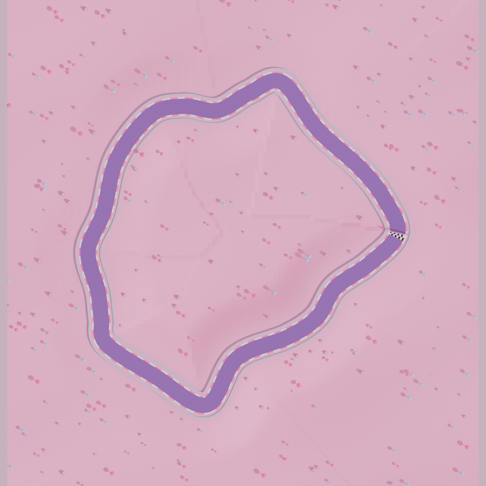

# Mascot Kart

A 3D mascot kart racer that runs in the browser. Every track is generated from a seed, and the same generator runs inside Blender to build the levels as real Blender scenes.



## Play

ES modules need a local web server (opening `index.html` from disk won't work):

```bash
npm start            # = python3 -m http.server 8000
# open http://localhost:8000
```

| Action | Keys | Touch |
| --- | --- | --- |
| Gas / brake + reverse | `W` `S` or `↑` `↓` | GO / ◼ |
| Steer | `A` `D` or `←` `→` | ◀ ▶ |
| Drift (hold while turning; release for a mini-turbo) | `Space` or `Shift` | ≈ |
| Use item | `E`, `X` or `Enter` | ★ |
| Back on track · camera · pause · mute | `R` · `C` · `Esc`/`P` · `M` | II |

**Rocket start:** press gas just after **2** shows on the countdown. Press too early and you stall.

### What's in it

- **6 levels:** Meadow Mile, Dune Dash, Frosty Peaks, Candy Canyon, Lava Loop and Star Circuit. Each has its own theme, scenery and difficulty. Finish in the top 3 to unlock the next one; progress and best times are saved in the browser.
- **Endless mode:** type any seed (1 to 999999) to get a new track. The difficulty scales with the seed, and the same seed always gives the same track, so you can share them.
- **6 mascots:** Bruno Bear, Pip Penguin, Fizz Fox, Hopper Frog, Bolt-O Bot and Bun Bun.
- **3 karts:** Classic, Bolt and Monster, in 8 paint colours. Mascot and kart stats combine (speed, acceleration, handling, weight).
- **Racing:** AI rivals with rubber-banding, drift mini-turbos, boost pads and item boxes (🔥 Turbo, 🔥🔥🔥 Triple Turbo, 🍌 Banana, 🫧 Shield). Racers further back get better items. There's also a minimap and on-screen touch controls.

## Procedural map generation

`js/trackgen.js` turns a level definition (`js/levels.js`) into a track:

1. **Control points:** a seeded `mulberry32` RNG places N points around a loop, jittering their angle, radius and height. Harder levels add extra wiggle points between them.
2. **Spline:** a closed Catmull-Rom spline is resampled to equal 2 m steps. Heights are smoothed so slopes stay drivable.
3. **Validation:** if the road comes within two road-widths of itself, or any slope is steeper than 30%, it regenerates with calmer jitter. `tests/track_sanity.test.mjs` checks 66 tracks.
4. **Layout:** boost pads, item-box rows and themed props (trees, cacti, pines, lollipops, lava rocks, crystals) are placed from separate RNG streams. Props are kept clear of the road.
5. **Terrain:** a height field hugs the track near the road and rolls into sine-noise hills further out.

The game uses the same data for physics: karts are projected onto the nearest track sample to get their height, lap progress and wall collisions.

## Building levels in Blender (Blender MCP)

`blender/build_level.py` is a single self-contained file. It is a line-for-line Python port of the generator plus a Blender scene builder. It builds the road, checkered start line, curbs, shoulders, walls, terrain, themed props, start arch, materials, world colour and sun, then exports `assets/levels/level_<n>.glb`.

When the game starts a level, it looks for that `.glb`. If it finds one, it swaps in the Blender scenery (you'll see "Blender scenery loaded"). Because both generators produce identical numbers (`tests/parity.test.mjs` checks this), the Blender meshes line up exactly with the track the karts drive on. If you edit a level in Blender by hand (decorations, lighting, materials), keep the road where it is and re-export.

The six levels are already built and committed in `assets/levels/`.

### With Blender MCP

1. Install [blender-mcp](https://github.com/ahujasid/blender-mcp): add its `addon.py` in Blender (Edit → Preferences → Add-ons → Install), then in the 3D view's sidebar (`N`) open the **BlenderMCP** tab and click **Connect to Claude**.
2. Register the MCP server with Claude Code: `claude mcp add blender uvx blender-mcp`.
3. Ask Claude something like:

   > Run `blender/build_level.py` in Blender with `execute_blender_code`. Set `LEVEL = 3` and `OUT_DIR = "/absolute/path/to/game/assets/levels"`.

   Or try `LEVEL = 0` with `SEED = 777` for a random track; the game loads it as `level_seed_777.glb`.

The `CONFIG` block at the top of the script controls `LEVEL`, `SEED`, `OUT_DIR`, `CLEAR_SCENE` and `RENDER_PREVIEW`. The script runs as-is under the MCP's `exec`; this has been tested.

### From the command line

```bash
npm run build:levels                                            # every level → assets/levels/
blender -b -P blender/build_level.py -- --level 4 --out assets/levels --preview /tmp/candy.png
blender -b -P blender/build_level.py -- --level 0 --seed 777 --out assets/levels
```

## Tests

```bash
npm test   # JS ↔ Python generator parity + track sanity (needs node and python3; no Blender needed)
```

## Layout

```
index.html            UI shell: menus, HUD, touch controls (Three.js from jsDelivr)
js/levels.js          themes + level definitions + random-seed levels
js/trackgen.js        seeded procedural track/terrain/prop generator (no Three.js)
js/world.js           Three.js scene from a track; optional Blender .glb swap-in
js/mascots.js         mascot + kart models and stats
js/racer.js           kart physics, laps, items, AI drivers, collisions
js/main.js            game states, race loop, camera, HUD, results, saving
js/input.js, audio.js keyboard/touch input, WebAudio blips
blender/build_level.py  Blender generator + scene builder + glTF export
assets/levels/        Blender-built levels
```
